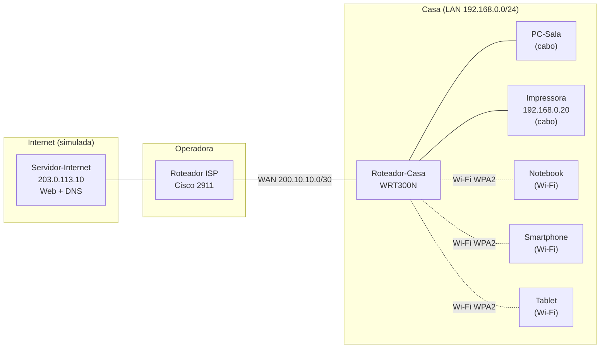

# 01 · Rede doméstica (SOHO)

## Problema

Uma família quer internet em casa para um PC de mesa, uma impressora, um notebook, um celular e um tablet. A rede precisa ser **fácil de usar** (os aparelhos recebem configuração automaticamente) e **segura** (vizinhos não podem entrar no Wi-Fi nem mexer no roteador).

## Solução

Rede SOHO (*Small Office / Home Office*) montada no **Cisco Packet Tracer**, com:

- **Roteador sem fio** fazendo três papéis: roteador, switch (portas LAN) e ponto de acesso Wi-Fi
- **DHCP** entregando IP automaticamente para os aparelhos
- **NAT**: todos os aparelhos da casa saem para a internet com um único IP público
- **Wi-Fi WPA2-Personal (AES)** com nome de rede (SSID) personalizado
- **Senha de administração** do roteador trocada (a padrão `admin` é a primeira que um invasor testa)
- **Impressora com IP fixo**, fora da faixa do DHCP, para não "sumir" da rede
- Uma **operadora (ISP) simulada**, com um servidor web e DNS representando a internet

## Topologia

<!-- Depois de montar, coloque o print da topologia aqui:

-->

## Endereçamento

| Rede / Aparelho | Endereço | Como recebe |
|---|---|---|
| LAN da casa | 192.168.0.0/24 | — |
| Roteador-Casa (lado LAN) | 192.168.0.1 | Fixo |
| Faixa do DHCP | 192.168.0.100 – 192.168.0.149 | — |
| Impressora | 192.168.0.20 | **Fixo** (fora da faixa do DHCP) |
| PC, notebook, celular, tablet | 192.168.0.100+ | DHCP |
| Link WAN casa ↔ operadora | 200.10.10.0/30 | — |
| Roteador ISP (lado cliente) | 200.10.10.1 | Fixo |
| Roteador-Casa (lado internet) | 200.10.10.2 | DHCP da operadora |
| Servidor-Internet | 203.0.113.10 | Fixo |

> 200.10.10.0/30 e 203.0.113.0/24 representam IPs públicos neste laboratório. Como a simulação é isolada, eles não conflitam com a internet de verdade.

## Decisões e por quê

| Decisão | Motivo |
|---|---|
| WPA2 com AES | É o padrão seguro amplamente compatível. WEP e WPA (TKIP) são quebráveis em minutos |
| Trocar a senha do roteador | Senhas padrão (`admin/admin`) são públicas e testadas primeiro por invasores |
| Impressora com IP fixo | Se o IP mudasse via DHCP, os computadores perderiam a impressora |
| DHCP para o resto | Ninguém da família precisa configurar nada; é só conectar |
| NAT | A operadora entrega **um** IP público; o NAT permite que todos os aparelhos o compartilhem |

## Testes

| # | Teste | Resultado esperado |
|---|---|---|
| 1 | `ipconfig` no PC-Sala | IP 192.168.0.1xx, gateway 192.168.0.1, DNS 203.0.113.10 |
| 2 | Notebook, celular e tablet conectam no Wi-Fi | Link sem fio aparece e cada um recebe IP |
| 3 | `ping 192.168.0.20` (impressora) | Resposta ✅ |
| 4 | `ping 203.0.113.10` (internet) | Resposta ✅ |
| 5 | Navegador → `http://www.meusite.com` | Página do servidor abre (DNS + HTTP funcionando) ✅ |
| 6 | Aparelho com **senha errada** do Wi-Fi | **Não** conecta ✅ |
| 7 | Modo Simulação: pacote saindo da casa | IP de origem muda de 192.168.0.x para 200.10.10.2 (NAT) ✅ |

<!-- Coloque os prints dos testes aqui:

-->

## O que aprendi

- A diferença prática entre **LAN** (dentro de casa) e **WAN** (o link com a operadora)
- Que um "roteador de casa" é, na verdade, **roteador + switch + ponto de acesso** em uma caixa só
- Como **DHCP, DNS e NAT** trabalham juntos para um site abrir
- O mínimo de segurança que toda rede doméstica deveria ter

## Arquivos

- [PASSO-A-PASSO.md](PASSO-A-PASSO.md): como montar do zero
- [configs/ISP.txt](configs/ISP.txt): configuração do roteador da operadora
