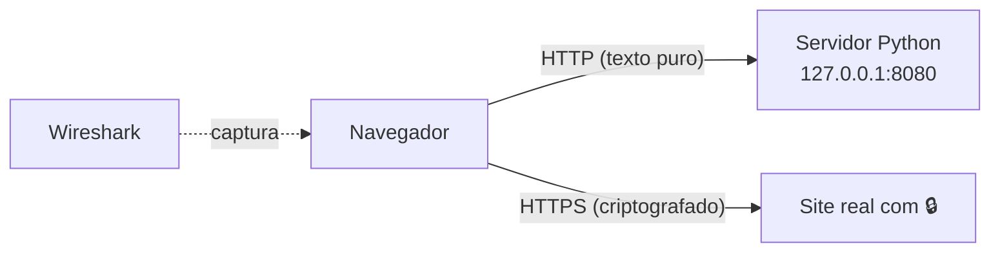

# 02 · Análise de tráfego com Wireshark

## Problema

"Wi-Fi público é perigoso" e "sempre confira o cadeado 🔒" são conselhos comuns, mas **por quê**? Este projeto prova na prática o que um atacante na mesma rede consegue (e não consegue) ver.

## Solução

Captura e análise de pacotes **na minha própria rede**, com o **Wireshark**, em seis experimentos:

| # | Experimento | O que mostra |
|---|---|---|
| 1 | Login em página **HTTP** | Usuário e senha aparecem **legíveis** no pacote |
| 2 | Acesso a site **HTTPS** | Conteúdo **embaralhado** (criptografia TLS); só o **nome do site** aparece |
| 3 | Consultas **DNS** | Como o nome `www.site.com` vira um endereço IP |
| 4 | **DHCP** (processo DORA) | Como o PC pede e recebe um IP ao entrar na rede |
| 5 | **ARP** e **ICMP** (ping) | Como o PC descobre o endereço físico do roteador e testa a conexão |
| 6 | **Handshake TCP** | Os três passos (SYN, SYN-ACK, ACK) antes de qualquer conexão TCP |

Para o experimento 1 eu escrevi um pequeno servidor em Python, [servidor_login_inseguro.py](servidor_login_inseguro.py), que simula uma página de login **sem criptografia**. Assim o teste é feito com dados inventados, num servidor meu, sem tocar em sites de terceiros.

## Resultados

**HTTP x HTTPS**

| | HTTP | HTTPS |
|---|---|---|
| Conteúdo da página | Legível | Embaralhado ("Application Data") |
| Usuário e senha do formulário | **Legíveis** (`usuario=aluno.teste&senha=SenhaFalsa123`) | Invisíveis |
| Nome do site visitado | Visível | **Ainda visível** (campo SNI do TLS) e na consulta DNS |

**Conclusão:** num Wi-Fi público, um atacante na mesma rede pode ler tudo o que vai por HTTP. Com HTTPS, ele vê **para qual site** você foi, mas **não o que você fez lá**. Por isso a regra do cadeado, e por isso uma VPN ajuda: ela esconde até os nomes dos sites.

<!-- Coloque os prints aqui:

-->

## Filtros do Wireshark usados

| Filtro | Para quê |
|---|---|
| `http.request.method == "POST"` | Achar o envio do formulário |
| `tls` | Ver o tráfego HTTPS |
| `tls.handshake.extensions_server_name` | Ver o nome do site dentro do HTTPS (SNI) |
| `dns` | Consultas de nome |
| `dhcp` | Pedido e entrega de IP |
| `arp \|\| icmp` | ARP e ping |
| `tcp.flags.syn == 1` | Início de conexões TCP |

## Ética

Todas as capturas foram feitas **na minha rede e nos meus aparelhos**. Capturar tráfego de redes ou pessoas sem autorização é crime (Lei 12.737/2012).

## O que aprendi

- Por que HTTPS é obrigatório para senhas e dados pessoais
- O que ainda vaza com HTTPS (nomes de sites) e como VPN e DNS criptografado ajudam
- Como DHCP, DNS, ARP e TCP funcionam "por dentro", pacote a pacote

## Arquivos

- [PASSO-A-PASSO.md](PASSO-A-PASSO.md): roteiro dos seis experimentos
- [servidor_login_inseguro.py](servidor_login_inseguro.py): servidor de login HTTP para o experimento 1
