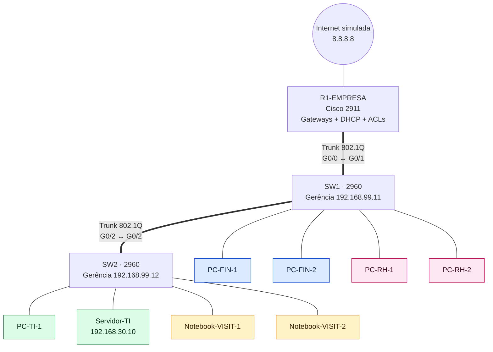

# 03 · Rede corporativa com VLANs

## Problema

Uma empresa pequena tem quatro setores no mesmo prédio: **Financeiro, RH, TI e uma área de Visitantes**. Hoje está tudo numa rede só, e qualquer visitante conectado consegue enxergar os computadores do Financeiro. A empresa precisa:

1. Separar os setores sem comprar um switch para cada um
2. Impedir que **visitantes** acessem qualquer coisa interna (só internet)
3. Impedir que o **RH** acesse o **Financeiro**
4. Permitir que **só a TI** administre os equipamentos de rede, de forma segura

## Solução

| Requisito | Como foi resolvido |
|---|---|
| Separar setores | **VLANs** 10, 20, 30 e 40 nos switches, uma por setor |
| Ligar switches e roteador carregando várias VLANs | **Trunks 802.1Q** |
| Setores conversarem quando permitido | **Roteamento entre VLANs** no R1 (*router-on-a-stick*, com subinterfaces) |
| IP automático em cada setor | **DHCP** no R1, um pool por VLAN |
| Visitantes só com internet | **ACL estendida** `VISITANTES-IN` |
| RH sem acesso ao Financeiro | **ACL estendida** `RH-IN` |
| Administração segura | **SSH** (no lugar de Telnet), usuário local e **ACL** liberando só a rede da TI |
| Endurecimento dos switches | Portas não usadas **desligadas** e numa VLAN "lixo" (999), `portfast` nas portas de usuário, VLAN de **gerência** separada (99) |

## Topologia



<!-- Depois de montar, coloque o print da topologia aqui:

-->

## Plano de VLANs e endereçamento

| VLAN | Nome | Rede | Gateway (R1) | DHCP entrega | Portas |
|---|---|---|---|---|---|
| 10 | FINANCEIRO | 192.168.10.0/24 | 192.168.10.1 | .11 – .254 | SW1 Fa0/1–10 |
| 20 | RH | 192.168.20.0/24 | 192.168.20.1 | .11 – .254 | SW1 Fa0/11–20 |
| 30 | TI | 192.168.30.0/24 | 192.168.30.1 | .21 – .254 | SW2 Fa0/1–10 |
| 40 | VISITANTES | 192.168.40.0/24 | 192.168.40.1 | .11 – .254 | SW2 Fa0/11–20 |
| 99 | GERENCIA | 192.168.99.0/24 | 192.168.99.1 | — (fixo) | SVI dos switches |
| 999 | NAO-USADAS | — | — | — | Portas desligadas |

| Equipamento | Endereço fixo |
|---|---|
| Servidor-TI (Web + DNS `intranet.empresa.lab`) | 192.168.30.10 |
| SW1 (gerência) | 192.168.99.11 |
| SW2 (gerência) | 192.168.99.12 |
| "Internet" (Loopback0 do R1) | 8.8.8.8 |

## Regras de acesso (ACLs)

```
VISITANTES-IN (entrada da VLAN 40)
  permite DHCP
  permite ping no próprio gateway
  BLOQUEIA 192.168.40.0/24 → 192.168.0.0/16 (toda a rede interna)
  permite o resto (internet)

RH-IN (entrada da VLAN 20)
  BLOQUEIA 192.168.20.0/24 → 192.168.10.0/24 (Financeiro)
  permite o resto
```

**Por que na entrada (`in`) e perto da origem?** ACL estendida olha origem **e** destino, então pode ficar perto de quem gera o tráfego. Assim o pacote proibido é descartado logo na chegada, sem gastar processamento do roteador.

## Testes

Matriz de conectividade (ping de quem está na linha para quem está na coluna):

| De ↓ / Para → | Financeiro | RH | TI (servidor) | Visitantes | Internet |
|---|---|---|---|---|---|
| **Financeiro** | ✅ | ❌ | ✅ | ❌ | ✅ |
| **RH** | ❌ | ✅ | ✅ | ❌ | ✅ |
| **TI** | ✅ | ✅ | ✅ | ❌ | ✅ |
| **Visitantes** | ❌ | ❌ | ❌ | ✅ | ✅ |

> Por que o Financeiro também não alcança o RH, e a TI não alcança os Visitantes? O pedido de ping **chega**, mas a **resposta** volta pela entrada da VLAN bloqueada e é descartada. Na prática, o isolamento vale nos dois sentidos, o que é o desejado aqui.

| Teste extra | Esperado |
|---|---|
| PC-FIN abre `http://intranet.empresa.lab` | ✅ Página abre |
| Notebook-VISIT abre `http://intranet.empresa.lab` | ❌ Não abre |
| PC-TI-1 → `ssh -l admin 192.168.30.1` | ✅ Entra no roteador |
| PC-RH-1 → `ssh -l admin 192.168.20.1` | ❌ Conexão recusada |
| Telnet de qualquer lugar | ❌ Recusado (só SSH) |
| `show access-lists` no R1 | Contadores de "matches" sobem nas linhas `deny` |

<!-- Coloque os prints dos testes aqui:


-->

## O que aprendi

- VLAN separa redes **logicamente** usando o mesmo switch físico
- Trunk carrega várias VLANs num só cabo, marcando cada quadro com a etiqueta 802.1Q
- Sem um roteador (ou switch camada 3), VLANs diferentes **não conversam**
- ACLs são lidas de cima para baixo, e todas terminam com um **"deny any" invisível**
- Segurança em camadas: VLAN + ACL + SSH + portas desligadas

## Próximos passos

- Ponto de acesso Wi-Fi na VLAN de Visitantes
- *Port security* (limitar MACs por porta) e *DHCP snooping*
- Trocar o R1 por um switch camada 3 (SVIs) e comparar desempenho

## Arquivos

- [PASSO-A-PASSO.md](PASSO-A-PASSO.md)
- [configs/R1-EMPRESA.txt](configs/R1-EMPRESA.txt) · [configs/SW1.txt](configs/SW1.txt) · [configs/SW2.txt](configs/SW2.txt)
