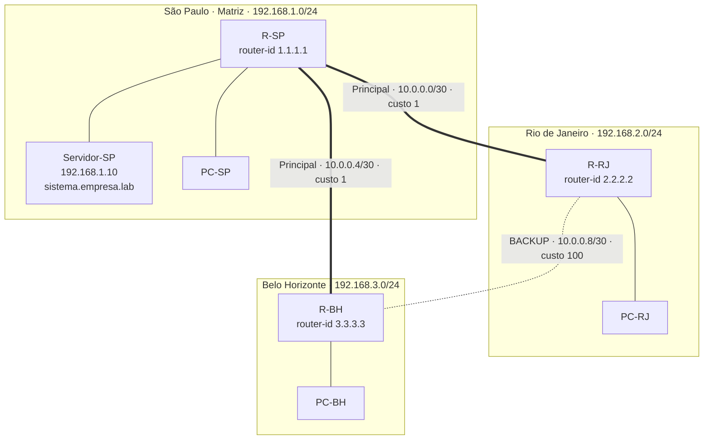

# 04 · WAN matriz e filiais com OSPF e redundância

## Problema

Uma empresa tem a **matriz em São Paulo** (onde fica o servidor do sistema) e **filiais no Rio de Janeiro e em Belo Horizonte**. As filiais precisam acessar o servidor da matriz, e a empresa **não pode parar** se um link entre cidades cair.

## Solução

- Três roteadores ligados em **triângulo**: cada cidade tem dois caminhos para as outras
- **OSPF** (área 0) para os roteadores **descobrirem as rotas sozinhos** e se adaptarem a falhas
- **Links principais** SP↔RJ e SP↔BH; link **RJ↔BH como backup**, com **custo OSPF 100** (só é usado se um principal cair)
- **Autenticação MD5 no OSPF**: um roteador estranho ligado na rede não consegue injetar rotas falsas
- **`passive-interface`** nas LANs: os roteadores não anunciam OSPF para os computadores dos usuários
- Sub-redes **/30** nos links ponto a ponto (só 2 IPs úteis, sem desperdício)
- **DHCP** em cada filial e **DNS** central na matriz

## Topologia

<!-- Depois de montar, coloque o print da topologia aqui:

-->

## Endereçamento

| Link / Rede | Sub-rede | Endereços |
|---|---|---|
| LAN São Paulo | 192.168.1.0/24 | R-SP G0/0 = .1 · Servidor = .10 · DHCP a partir de .21 |
| LAN Rio de Janeiro | 192.168.2.0/24 | R-RJ G0/0 = .1 · DHCP a partir de .11 |
| LAN Belo Horizonte | 192.168.3.0/24 | R-BH G0/0 = .1 · DHCP a partir de .11 |
| SP ↔ RJ (principal) | 10.0.0.0/30 | R-SP G0/1 = .1 · R-RJ G0/1 = .2 |
| SP ↔ BH (principal) | 10.0.0.4/30 | R-SP G0/2 = .5 · R-BH G0/1 = .6 |
| RJ ↔ BH (backup) | 10.0.0.8/30 | R-RJ G0/2 = .9 · R-BH G0/2 = .10 |
| Loopbacks (router-id) | /32 | 1.1.1.1 · 2.2.2.2 · 3.3.3.3 |

## Como o backup funciona

O OSPF escolhe sempre o caminho de **menor custo total**. Exemplo, da filial **RJ** até a LAN de **BH**:

| Caminho | Custo | Situação normal |
|---|---|---|
| RJ → SP → BH | 1 + 1 + 1 = **3** | ✅ Escolhido |
| RJ → BH direto (backup) | 100 + 1 = **101** | Reserva |

Se o link **SP↔BH cair**, o caminho de 3 deixa de existir, e o OSPF passa a usar o backup **automaticamente, em segundos**, sem ninguém mexer em nada.

## Testes

| # | Teste | Esperado |
|---|---|---|
| 1 | `show ip ospf neighbor` em cada roteador | 2 vizinhos em estado **FULL** |
| 2 | `show ip route ospf` no R-RJ | Rede 192.168.3.0 aprendida **via 10.0.0.1** (passando por SP) |
| 3 | PC-RJ → `tracert` para o PC-BH | Caminho passa por **10.0.0.1** (SP) |
| 4 | PC-BH → `ping -n 50 192.168.1.10` e **derrubar o link SP↔BH** no meio | Perde poucos pacotes e **volta sozinho** |
| 5 | PC-BH → `tracert 192.168.1.10` com o link caído | Caminho agora passa por **10.0.0.9** (RJ) e depois **10.0.0.1** |
| 6 | Religar o link | Rotas voltam ao caminho principal |
| 7 | Trocar a senha OSPF de um lado | Vizinhança **cai** (a autenticação protege) |
| 8 | PC de qualquer filial → `http://sistema.empresa.lab` | Página do servidor abre |

<!-- Coloque os prints dos testes aqui:

-->

## O que aprendi

- Roteamento **dinâmico** x estático: com OSPF, os roteadores se reorganizam sozinhos
- Como o **custo** controla qual link é principal e qual é reserva
- Por que usar **/30** em links ponto a ponto e **loopback** como router-id
- Proteger o protocolo de roteamento com **autenticação**

## Próximos passos

- Simular a internet na matriz e distribuí-la às filiais com `default-information originate`
- Dividir em várias áreas OSPF
- Trocar MD5 por autenticação SHA (*OSPF key chain*) em equipamentos que suportem

## Arquivos

- [PASSO-A-PASSO.md](PASSO-A-PASSO.md)
- [configs/R-SP.txt](configs/R-SP.txt) · [configs/R-RJ.txt](configs/R-RJ.txt) · [configs/R-BH.txt](configs/R-BH.txt)
