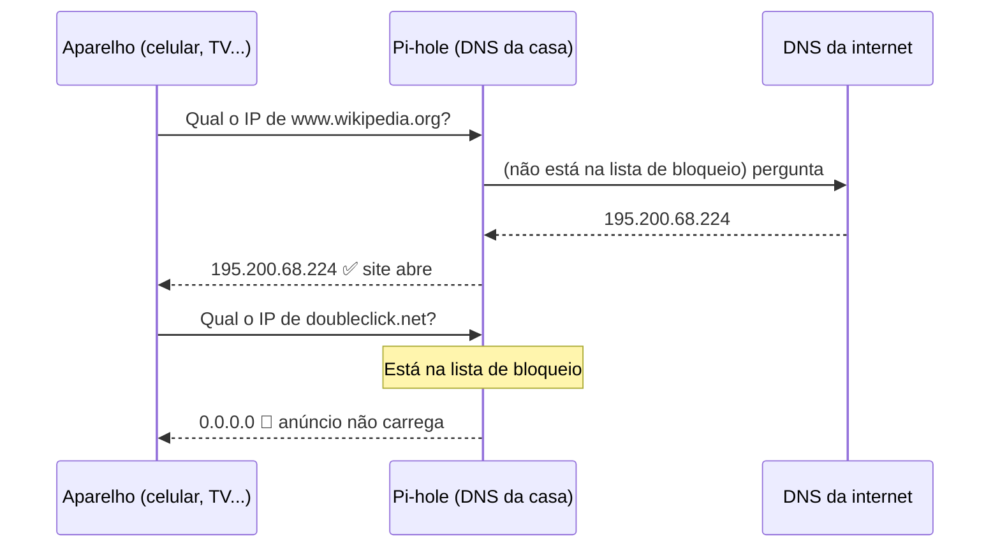
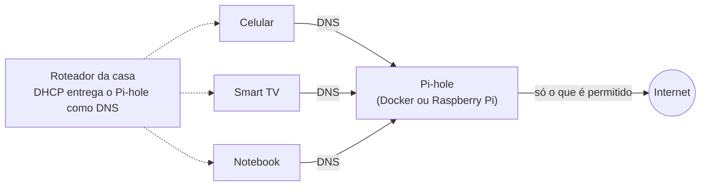

# 05 · Bloqueador de anúncios para a rede inteira (Pi-hole)

## Problema

Em casa há vários aparelhos (celulares, Smart TV, notebooks). Instalar bloqueador de anúncios em cada um é trabalhoso, e em alguns (como a TV) é impossível. Além disso, muitos aparelhos enviam dados para **rastreadores** sem o usuário saber.

## Solução

Um servidor **DNS** próprio com o **Pi-hole**, rodando em **Docker** (ou num Raspberry Pi), que bloqueia anúncios e rastreadores para **todos os aparelhos da rede de uma vez**, sem instalar nada neles.

### Como funciona

Antes de acessar qualquer site, o aparelho pergunta ao **DNS**: "qual é o IP de `anuncio.com`?". O Pi-hole fica no meio dessa pergunta:





## Tecnologias

| Item | Uso |
|---|---|
| **Pi-hole** | Servidor DNS com listas de bloqueio e painel web |
| **Docker Compose** | Sobe o Pi-hole com um comando, configuração versionada em [docker-compose.yml](docker-compose.yml) |
| **Arquivo `.env`** | Guarda a senha do painel **fora** do código (está no `.gitignore`) |
| **PowerShell** | [testar-pihole.ps1](testar-pihole.ps1): teste automático de bloqueio |

## Decisões e por quê

| Decisão | Motivo |
|---|---|
| Bloqueio por DNS | Funciona em **qualquer** aparelho, inclusive TV e videogame, sem instalar nada |
| Docker | Instalação e atualização em um comando; nada fica "sujo" no sistema |
| Senha em `.env` | Senha nunca vai para o GitHub |
| Painel na porta 8080 | Evita conflito com outros serviços que usam a porta 80 |
| Volume `etc-pihole/` | Configurações sobrevivem a atualizações do contêiner |
| Script de teste | Validação repetível: prova o bloqueio em segundos, sem depender de "achismo" |

## Testes

Script automatizado:

```powershell
.\testar-pihole.ps1 -Servidor 192.168.0.50
```

Saída esperada:

```
Dominios de anuncio (devem ser BLOQUEADOS):
  [OK]    doubleclick.net           -> 0.0.0.0
  [OK]    ad.doubleclick.net        -> 0.0.0.0
  [OK]    googleadservices.com      -> 0.0.0.0
  [OK]    adservice.google.com      -> 0.0.0.0

Sites normais (devem FUNCIONAR):
  [OK]    www.google.com            -> 142.251.152.119, ...
  [OK]    www.wikipedia.org         -> 195.200.68.224
  [OK]    github.com                -> 4.228.31.150

Resultado: 7 de 7 testes OK. O Pi-hole esta funcionando.
```

O script também foi validado contra um DNS **sem** bloqueio (detecta as 4 falhas e sai com código 1) e contra um IP inexistente (avisa que o servidor não respondeu e sai com código 2).

| Teste manual | Esperado |
|---|---|
| Painel → *Query Log* | Consultas de todos os aparelhos aparecendo |
| Painel → *Dashboard* | Porcentagem de consultas bloqueadas |
| Site com muitos anúncios, antes x depois | Espaços de anúncio vazios |

<!-- Coloque os prints aqui:


-->

## O que aprendi

- O papel do **DNS** em toda conexão, e como controlá-lo dá poder sobre a rede inteira
- Rodar serviços de rede em **contêineres**
- Separar **segredos** (senhas) do código
- Automatizar testes de infraestrutura

## Próximos passos

- Rodar 24h num **Raspberry Pi** e configurar o roteador para entregar o Pi-hole via DHCP
- Ter **dois** Pi-hole para alta disponibilidade
- Usar DNS criptografado (DoH/DoT) entre o Pi-hole e a internet

## Arquivos

- [PASSO-A-PASSO.md](PASSO-A-PASSO.md)
- [docker-compose.yml](docker-compose.yml) · [.env.example](.env.example) · [testar-pihole.ps1](testar-pihole.ps1)
